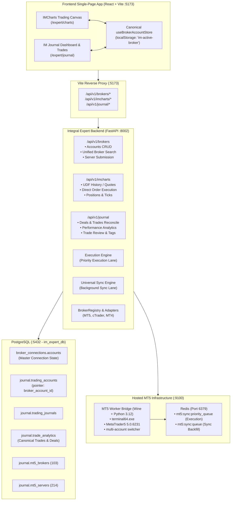
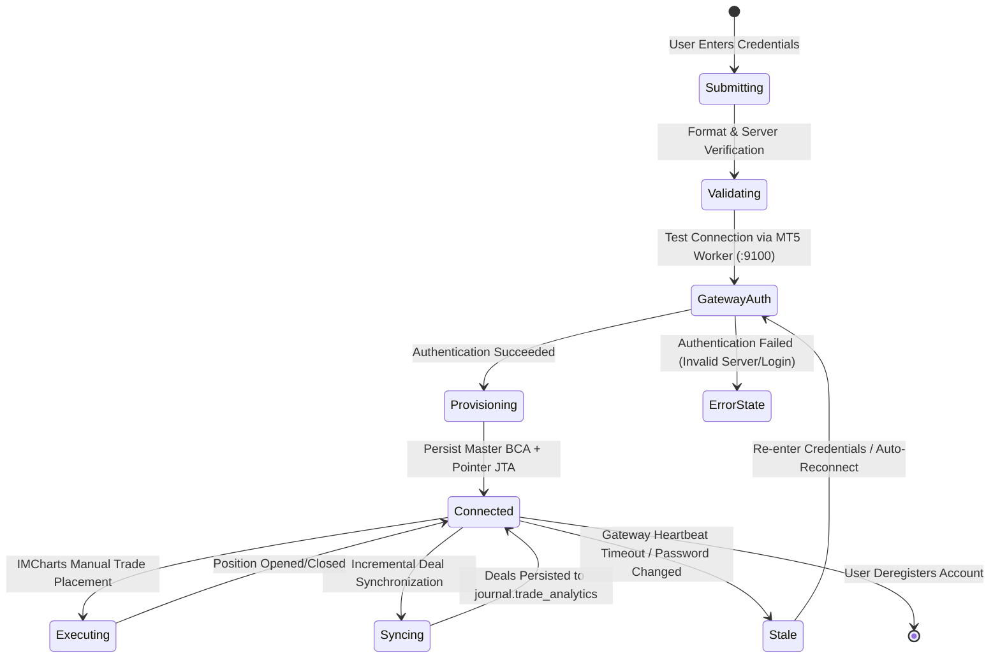

# IMCharts + IM Journal — System Architecture Dossier

**Document Version:** 1.0.0  
**Status:** Approved for Implementation  
**Target Services:** `integral-expert-backend` (Port 8002), `infrastructure/mt5-worker` (Port 9100), `app` (Frontend Preview Port 5173), `im_expert_db` (PostgreSQL 5432)

---

## 1. Executive Summary & Core Engineering Axiom

The **Integral Market** platform requires an institutional-grade, unified manual chart trading and trade journaling environment. Previously, account models across onboarding, execution, and journaling contained divergence risks between `broker_connections.accounts` and `journal.trading_accounts`.

**The Supreme Canonical Account Rule:**
There is exactly **one canonical broker account** per user brokerage connection. Every execution request in IMCharts, every synced trade in IM Journal, every risk rule check, and every chart workspace MUST resolve to the canonical identifier:
$$\text{Account ID} \equiv \text{broker\_connections.accounts.id} \equiv \text{journal.trading\_accounts.broker\_account\_id}$$

Under no circumstances may an account exist in IMCharts without immediate visibility in IM Journal, nor may an account connected in IM Journal fail to execute in IMCharts.

---

## 2. Service Boundaries & System Topology

---

## 3. Canonical Account Data Model & State Machine

### 3.1 Relational Schema Alignment
1. **Master Connection Record**: `broker_connections.accounts`
   - `id` (UUID): The authoritative system-wide account identifier.
   - `user_id` (UUID): Account owner.
   - `broker_name`: e.g. "Exness", "Headway", "IC Markets".
   - `server`: Exact broker server name matching MT5 terminal (e.g. `Exness-MT5Real`, `Headway-Demo`).
   - `account_number`: Login ticket.
   - `credentials_encrypted`: Fernet/AES-GCM encrypted payload (`{"password": "...", "server": "..."}`).
   - `connection_status`: `'connected'`, `'stale'`, `'disconnected'`, `'error'`.
   - `is_demo`: Boolean.
   - `last_balance`, `last_equity`, `last_margin`, `last_free_margin`, `currency`, `leverage`.

2. **Journal Account Pointer**: `journal.trading_accounts`
   - `id` (UUID): Internal journal account ID.
   - `broker_account_id` (UUID): Foreign key strictly referencing `broker_connections.accounts.id`.
   - `user_id` (UUID): Matches owner.
   - `lifecycle_state`: `'active'`, `'provisioning'`, `'connected'`, `'stale'`, `'suspended'`.

3. **Trading Journal Record**: `journal.trading_journals`
   - `account_id` (UUID): points to `journal.trading_accounts.id`.
   - `unified_account_id` (UUID): points to `broker_connections.accounts.id`.

### 3.2 Account Connection Lifecycle State Machine

---

## 4. MT5 Gateway Dual-Lane Execution & Sync Architecture

To prevent long-running history synchronization or bulk backfills from blocking high-priority manual order execution in IMCharts, the system implements **Lane Separation**:

1. **High-Priority Execution Lane (`mt5:sync:priority_queue`)**:
   - Market orders, limit orders, SL/TP modifications, and position closures.
   - Execution timeout: $\le 3000\text{ ms}$.
   - Directly interrupts non-critical polling.
   - Emits `trade.opened`, `trade.closed`, `trade.modified` to Redis Streams immediately.

2. **Standard Background Sync Lane (`mt5:sync:queue`)**:
   - Initial 90-day history backfill, periodic candle updates, and daily deal reconciliation.
   - Concurrency controlled to prevent terminal IPC lock contention.
   - Reconciles individual MT5 deals (`ENTRY_IN`, `ENTRY_OUT`, `ENTRY_INOUT`) into atomic closed trades in `journal.trade_analytics`.

---

## 5. Frontend Unified Store Architecture

The frontend leverages `useBrokerAccountStore` (`im-active-broker` in localStorage):
- **Selected Account ID**: References canonical `broker_connections.accounts.id`.
- Selecting an account in the IMCharts header (`BrokerSelector`) automatically updates:
  1. `ChartCanvas`: refreshes tick subscriptions, symbol permissions, and trade markers.
  2. `OrderPanel`: binds account balance, risk calculations, and execution tickets.
  3. `BottomPanel`: streams active positions and open orders for the selected account.
  4. `TradingJournalModule` & `TradeHistoryPage`: filters trades and analytics to the active account seamlessly.
