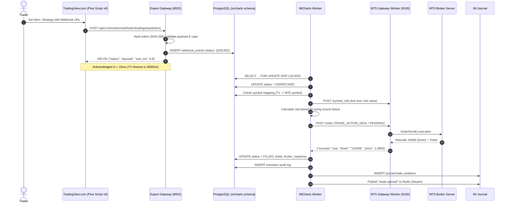

# IMCharts ViewLink-Inspired TradingView Webhook Bridge — System Architecture

**Document Version:** 1.1.0  
**Feature:** IMCharts Execution Bridge  
**Reference Architecture:** ViewLink (https://www.viewlink.dev/)  
**Target Platform:** TradingView.com (Alerts, Webhooks, Pine Script v6)  
**Execution Target:** MetaTrader 5 (Hosted Wine container, port 9100)  
**Reconciliation & Analytics:** IM Journal (`journal.trade_analytics`) & Redis Streams (`im:expert:trades`)

---

## 1. Executive Summary

IMCharts is an institutional-grade webhook execution bridge connecting trader market analysis on `https://www.tradingview.com/chart/` directly to MetaTrader 5 broker accounts.

Traders perform all technical analysis, layout design, indicator computation, and strategy testing on the official TradingView platform. When conditions trigger, TradingView fires an authenticated HTTP POST webhook to Integral Market's ingestion gateway. Within milliseconds, the system validates the payload, applies account risk caps, queues the order in PostgreSQL (`FOR UPDATE SKIP LOCKED`), dispatches it to the dedicated MT5 worker, and auto-journals confirmed fills into the trader's IM Journal.



---

## 2. Core Architectural Pillars

### 2.1 Decoupled Ingress & Execution
- **TradingView Webhook SLA**: TradingView has a strict 3.0-second HTTP delivery timeout. Connecting to an MT5 broker terminal synchronously during the HTTP request is an anti-pattern that causes frequent 504 timeouts during network spikes or market volatility.
- **Immediate Durability**: The public webhook endpoint performs authentication, payload syntax validation, risk cap checking, and writes to `imcharts.webhook_events` with an idempotency constraint in **under 15 milliseconds**.
- **Asynchronous Execution Loop**: The background `IMChartsBridgeWorker` continuously dequeues `QUEUED` records using `FOR UPDATE SKIP LOCKED`, handles execution against MT5, and records transitions.

### 2.2 Security & Credential Isolation
- **One-Way Token Hashing**: Webhook secrets generated for traders (`tv_sec_...`) are never stored in plaintext in the database. Only the SHA-256 hash digest is persisted (`imcharts.webhooks.token_hash`).
- **Token Rotation & Instant Revocation**: Traders can rotate their webhook token with 1 click in `TradingViewBridgeModal`. The previous token is revoked immediately.
- **Strict Guardrail Enforcement**: Webhook endpoints enforce server-side risk limits (`max_risk_percent`, `max_volume`, `max_age_seconds`, `allow_live`). If an incoming payload specifies risk or volume exceeding the webhook configuration, the order is rejected immediately.

### 2.3 Idempotency & Clock-Drift Prevention
- **Event ID Idempotency**: TradingView alerts can specify unique `event_id` values. If an `event_id` has already been processed for this webhook, duplicate execution is blocked.
- **Payload Hash Idempotency**: If no `event_id` is supplied, a SHA-256 fingerprint of `(webhook_id, event_type, symbol, side, rounded_minute)` blocks duplicate alert triggers within 60 seconds.
- **Max Age Threshold**: Stale alerts (due to internet drops or delayed webhook retries) older than `max_age_seconds` (default: 120s) are immediately rejected with status `EXPIRED`.

---

## 3. Pine Script v6 Integration Specification

The official companion script is located at:
`docs/imcharts/pine-script/Integral_Market_MT5_Execution_Bridge_v1.0.pine`

### Features:
1. Built exclusively with `//@version=6`.
2. Fully configurable order parameters:
   - Direction: `BUY` / `SELL`
   - Order Type: `MARKET`, `LIMIT`, `STOP`
   - Sizing Mode: `RISK_PERCENT` vs `FIXED_VOLUME`
   - Stop Loss Modes: Points/Pips vs Manual Price
   - Take Profit Modes: Risk:Reward Multiple vs Manual Price
3. Visual chart overlays:
   - Dynamic lines for Planned Entry, Stop Loss, and Take Profit
   - Interactive Diagnostics table displaying real-time R:R ratio, sizing, and payload readiness
4. Output payload conforming to canonical JSON Schema `v1.0`:
```json
{
  "schema_version": "1.0",
  "event_id": "tv_1730000000_12345",
  "event_type": "OPEN_MARKET",
  "source": "TRADINGVIEW_PINE_V6",
  "symbol": "EURUSD",
  "ticker_id": "FX:EURUSD",
  "timeframe": "60",
  "side": "buy",
  "order_type": "market",
  "quantity_mode": "risk_percent",
  "risk_percent": 1.0,
  "stop_loss": 1.08000,
  "take_profit": 1.09000,
  "timestamp": 1730000000
}
```

---

## 4. IM Journal & Event Bus Reconciliation

Upon successful execution of a trade through MT5:
1. `IMChartsBridgeWorker` records status `FILLED` with the broker ticket.
2. It auto-journals the trade directly into `journal.trade_analytics`:
   - Account ID, symbol, action, volume, open price, open timestamp, broker ticket.
   - Tagged as `TradingView Alert Webhook #<id>`.
3. It publishes a `trade.opened` event to Redis Streams (`im:expert:trades`), broadcasting real-time updates to all connected browser clients.
