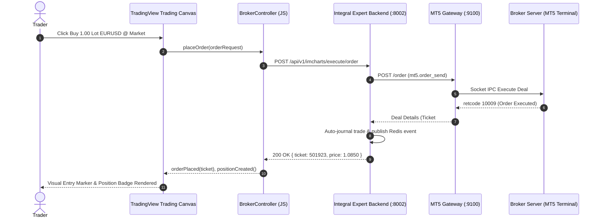

# TradingView Integration & Charting Architecture Dossier

> **SUPERSEDED (2026-11-03):** The "recommended architecture" in section 6 (Lightweight Charts as IMCharts) does not meet the IMCharts product definition. See `imcharts_tradingview_feasibility_report.md`.

**Author:** Antigravity Principal Engineering & Financial Systems Architecture  
**Document Version:** 1.0.0  
**Status:** Canonical Engineering Reference  
**Audience:** Executive Leadership, Engineering, Product & Compliance  

---

## 1. Executive Summary

This dossier provides a comprehensive technical, financial, and legal assessment of **TradingView charting and execution technologies** for the **Integral Market / IMCharts / IM Journal** ecosystem.

As Integral Market scales to provide institutional-grade trading tools, this document answers:
1. What are the formal distinctions, capabilities, and restrictions of each TradingView product tier?
2. How do UDF and JS API datafeeds operate, and how does Integral Market serve them?
3. What are the exact licensing, compliance, and legal hurdles for embedding TradingView hosted charts and broker execution?
4. What is the optimal technical strategy for Integral Market?

---

## 2. TradingView Product Tier Comparison Matrix

TradingView offers four distinct tiers of charting technology. It is vital not to conflate them:

| Tier | License & Cost | Host Model | Trading / Order Execution | Custom Indicators & Pine Script | Datafeed Protocol |
| :--- | :--- | :--- | :--- | :--- | :--- |
| **1. Lightweight Charts™** *(Active in IMCharts & IM Journal)* | Open Source (Apache 2.0) · **$0** | Client-side bundle (`npm i lightweight-charts`) | Native custom UI (Integral Market OrderPanel) | Canvas-based indicators (SMA, EMA, RSI, Volume) | Any (REST, WebSocket, Direct MT5 Gateway) |
| **2. Technical Analysis Charts (Hosted Widget)** | Free (Proprietary with TradingView branding & backlink) | Hosted `<iframe>` / Web Component | ❌ No custom broker execution | ❌ TradingView default scripts only | TradingView public data feeds |
| **3. Charting Library (Advanced Charts)** | Free upon GitHub B2B Agreement approval (Attribution required) | Self-hosted static bundle (`charting_library/`) | ❌ Charting only; No Order Ticket or DOM | ✅ Pine Script via TradingView servers or custom Pine engine | Custom JS API / UDF REST API |
| **4. Trading Platform** | Paid Enterprise B2B License ($15k–$60k+/yr + NDA) | Self-hosted static bundle (`trading_platform/`) | ✅ Built-in Order Ticket, DOM Ladder, Position Markers | ✅ Full Pine Script integration | Custom JS API + TradingView Broker API (`BrokerController`) |

---

## 3. Datafeed Protocols: UDF vs JS API

To display candlestick charts and indicators, TradingView-compatible engines interface with backend data feeds using two standard architectures:

### 3.1 Universal Data Feed (UDF)
The Universal Data Feed is a lightweight REST protocol established by TradingView:

- `GET /config`: Returns exchange features (resolutions, symbol types, supports_search, supports_group_request, supports_marks).
- `GET /symbols?symbol=EURUSD`: Returns symbol specifications (minmov, pricescale, session, timezone, ticker, currency).
- `GET /history?symbol=EURUSD&resolution=60&from=1700000000&to=1700086400`: Returns bar arrays (`s`: status, `t`: timestamps, `o`: open, `h`: high, `l`: low, `c`: close, `v`: volume).
- `GET /marks?symbol=EURUSD&from=...&to=...`: Returns historical trade marks (entry arrows, exit badges, realized PnL).
- `GET /quotes?symbols=EURUSD,GBPUSD`: Returns real-time quotes (bid, ask, volume).

**Integral Market Implementation Status:**  
Implemented and active at:  
`GET /api/v1/imcharts/udf/config`  
`GET /api/v1/imcharts/udf/symbols`  
`GET /api/v1/imcharts/udf/history`  
`GET /api/v1/imcharts/udf/quotes`  
`GET /api/v1/imcharts/udf/marks`

### 3.2 JavaScript API (Datafeed Object)
For lower latency or bidirectional WebSockets, a JavaScript object implementing the `IBasicDataFeed` interface is injected into the chart constructor:
```typescript
interface IBasicDataFeed {
  onReady(callback: (config: DatafeedConfiguration) => void): void;
  searchSymbols(userInput: string, exchange: string, symbolType: string, onResult: SearchSymbolsCallback): void;
  resolveSymbol(symbolName: string, onResolve: ResolveSymbolCallback, onError: ErrorCallback): void;
  getBars(symbolInfo: LibrarySymbolInfo, resolution: string, periodParams: PeriodParams, onResult: HistoryCallback, onError: ErrorCallback): void;
  subscribeBars(symbolInfo: LibrarySymbolInfo, resolution: string, onRealtimeCallback: SubscribeBarsCallback, listenerGuid: string, onResetCacheNeededCallback: () => void): void;
  unsubscribeBars(listenerGuid: string): void;
}
```

---

## 4. Execution Integration & Broker API

TradingView's **Trading Platform** tier enables manual order execution directly through the chart via the `BrokerController` specification.

### 4.1 Interface Architecture


---

## 5. Legal, Financial, and Compliance Assessment

### 5.1 TradingView Licensing Barriers
1. **GitHub Application Requirement**: Access to the TradingView Charting Library and Trading Platform source code is gated behind a closed GitHub organization. Approval requires:
   - A registered corporate entity with a verifiable trading-related website.
   - Formal agreement with TradingView Inc. terms of service.
   - Non-negotiable display of TradingView attribution logo unless an enterprise buyout agreement is executed.
2. **Financial Cost**:
   - The *Technical Analysis Charting Library* is free upon application for companies with under \$5M revenue, provided attribution is maintained and no order execution features are modified into it.
   - The *Trading Platform* (with native order routing) carries an annual enterprise fee typically ranging from **\$15,000 to \$60,000 USD/year** plus integration audit fees.

### 5.2 Market Data Redistribution Rights
- **Exchange Data Liabilities**: Redistributing real-time Level 1/Level 2 market data from NYSE, NASDAQ, CME, CBOE, or LSE requires formal data vendor agreements and monthly per-user exchange fees ($5 to $100+/mo per non-professional subscriber).
- **Forex and CFD Advantage**: Forex, crypto, and OTC CFD data streams generated by the user's own connected MT5 terminal under Wine do not incur exchange redistribution fees because the data is queried directly from the user's authenticated brokerage account for personal analysis.

---

## 6. The Integral Market Recommended Architecture

To maintain **100% operational autonomy, institutional responsiveness, and zero recurring third-party licensing overhead**, Integral Market employs a **tripartite charting and execution architecture**:

1. **Native Institutional Charting (IMCharts via Lightweight Charts v5)**:
   - High-performance, Canvas-accelerated rendering.
   - Zero vendor lock-in; 100% customizable dark aesthetic (`#0B1120`, `#0F1929`).
   - Binary search bar-snapping (`snapToNearestCandleTime`).
   - Integrated manual Order Ticket, pip risk calculator, R:R ratio, and Stop Loss / Take Profit dragging lines.
2. **ViewLink-Inspired MT5 Execution Gateway**:
   - Hosted Wine + Python 3.12 + MetaTrader 5 micro-container (`infrastructure/mt5-worker`).
   - Multi-account switching pool supporting 20+ accounts simultaneously.
   - Sub-second trade execution via direct Windows IPC and REST `/order`.
3. **External TradingView Library Readiness**:
   - The backend `/api/v1/imcharts/udf/*` endpoints are strictly compatible with TradingView's UDF specification.
   - Whenever an enterprise license is acquired, the TradingView Charting Library can be dropped in as an alternative renderer without changing a single backend database table, API route, or account model.
